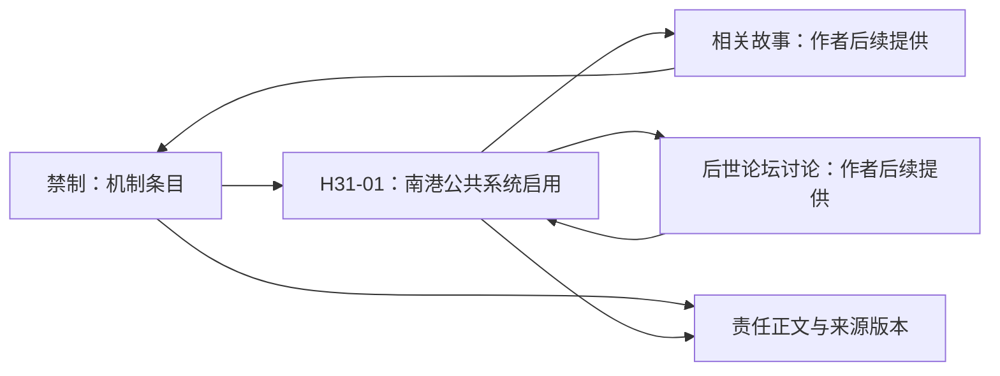
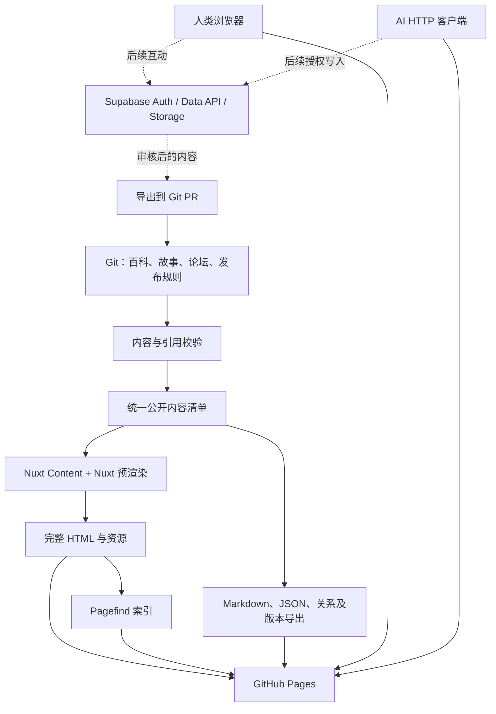

# 赫特维拉世界观网站设计书

版本：0.2 · 更新日期：2026-10-25 · 设定基线：3.0.3

本文保留完整产品与技术规划。当前已实现并部署首页、“禁制—H31-01”两个互链节选、静态搜索和机器导出；前端已接入分层设计系统、浅／深色主题与官方 Nuxt UI 技能。当前功能与运行方式以 [README](../README.md) 为准，视觉实现规范以 [设计系统](design-system.md) 为准。故事、论坛、完整设定迁移和动态后端仍属于后续阶段；本设计中的其他路由、字段与接口不表示已实现。

**推荐方案：Nuxt 4 + Nuxt UI 4 + Nuxt Content 3，以 Git 中的 Markdown 为正式内容来源，预生成 HTML 部署到 GitHub Pages；Pagefind 提供站内全文检索；后续以 Supabase 承接登录、投稿、评论和管理 API。** 人类页面与 AI 使用的 Markdown、JSON 从同一份内容生成。

已经确认的范围：**首版由作者维护 Wiki、故事和模拟论坛，后续再开放登录与真实互动。** 首版不需要 Supabase 才能运行；数据模型、内容编号和接口约定提前为扩展做好准备。

## 1. 产品目标与范围

网站有三个互相连通的阅读空间：

| 空间 | 读者的问题 | 主要内容 | 阅读方式 |
| --- | --- | --- | --- |
| 设定百科 | “这是什么，为什么如此？” | 概念、人物、地点、制度、事件、生活与技术 | 检索、分类、上下文链接、关联条目 |
| 故事书架 | “这件事如何被经历？” | 小说、短篇、系列、人物片段、书信等 | 连续阅读、系列顺序、关联设定 |
| 世界内论坛 | “生活在这里的人如何讨论？” | 主题帖、楼层、引用、网友讨论与同人连载 | 版块、主题列表、楼层、用户档案 |

百科提供作者层的客观解释；故事提供叙述视角；论坛呈现世界内发言者的知识、立场和误解。关联是阅读入口，不自动表示内容相互证明。

首版必须包含：

- 可按概念、别名、编号、分类和年代查阅的完整设定入口。
- Wiki、故事、论坛之间的显式链接、自动反向链接和相关内容列表。
- 故事的系列、章节、阅读顺序、设定依据与适用范围。
- 有真实论坛视觉与浏览方式的静态主题、楼层、虚构用户及同人作品入口。
- 无登录即可阅读、适合手机和键盘操作、正文可直接通过 HTTP 获取。
- 作者以 Markdown 和 Git 管理内容；自动校验、构建与部署。
- 面向 AI 的版本索引、原文、结构化关系和引用坐标。

后续阶段才加入真实账号、收藏同步、投稿、现实读者评论、审核后台和动态内容 API。全文问答机器人、向量数据库、实时聊天室、复杂关系图编辑器和地图引擎不属于首版。

## 2. 附件分析及其设计影响

### 2.1 本次实际检查

附件为 `赫特维拉统合设定_3.0.3.zip`。本次对全包进行了文件、显式锚点及校验表盘点，并精读入口、责任边界、纪年、编号、写作规则、事实与名称状态、维护规范、公众知识，以及代表性人物索引和历史正文。没有将结构盘点等同于逐句审读全部设定。

| 项目 | 检查结果 |
| --- | --- |
| ZIP 文件数量 | 228 |
| Markdown 文档 | 216，与发布清单一致 |
| 校验表覆盖 | 219 个内容文件，独立计算 SHA-256 全部一致 |
| 显式 HTML 锚点 | 1,855 个，编号无重复 |
| H 系列历史 | H01—H51；546 个事件锚点 |
| 其他时间坐标 | Era 1—13、S01—S21；各自表达不同维度 |
| 当前世界年 | 2026 年；不是浏览器或服务器的现实当前年份 |

本次完整 ZIP 的 SHA-256：

```text
15a77fe306250568bdb9bf535dc2b9e272bad7fb9bcb8b1d05eaba5a1135ce8b
```

附件主要是设定资料，不能把其中的历史概述、写作示例和维护材料直接计作已经完成的故事库或论坛库。首版故事、帖子需要作者提供或在后续创作任务中另行编写；空列表使用正常空状态，不伪造作品、读者和互动记录。

### 2.2 必须保留的语义

| 原资料中的约束 | 网站设计 |
| --- | --- |
| 主定义按主题负责；摘要不覆盖主定义 | 每个条目和关键段落保存责任来源；关联摘要链接到主定义 |
| CANON、OPEN、WORKING、STORY-LOCAL、DEPRECATED 不同 | 独立事实状态字段；不能把所有页面都标为“正式设定” |
| 名称未定不代表机制未定 | 名称状态与事实状态分开，例如“秩序力量”的工作名称与已定机制 |
| EXAMPLE 是示例标记 | 作为独立注记，不升级为全国普遍情况或固定历史 |
| 作者知道、人物当时知道、后世解释不同 | 保存叙述层级、认知范围及适用年代；论坛不继承百科的全知视角 |
| 原生世界时间不可统一换算 | 时间轴有多个世界及相对顺序；不强行放进统一精确年份 |
| 前1年之后是0年，再到1年 | 使用专门的世界纪年字段，不用公历日期库模拟 |
| H、Era、S 不是同一种分期 | 可交叉筛选，不建立假定的一对一映射 |
| 人物百科标题要用全名 | 常用名用于搜索与自然阅读，标题保留完整姓名 |
| 世界内论坛作者把六人当作同世界中的现实人物 | 创作说明放在网站外层；虚构楼层不讨论“官设”“角色”等作者层概念 |

需要特别防止的误归并包括：原生伊拉奈德文明与现代伊拉奈德教国、人物维萨尔与地名维萨、古代莱维娅·塞恩与现代维娅·塞恩。搜索可以同时呈现候选，不能自动断言它们是同一对象或存在亲属关系。

### 2.3 “完整设定”如何落地

完整性以**可检索、可到达、可追溯的内容覆盖**衡量，不以首页目录看起来齐全衡量。

1. 按来源章节、锚点和表格行建立迁移清单，逐项指向网站中的主定义位置。
2. 原文内容在重组过程中必须有可读落点：优先形成百科条目；尚未重编的部分提供“资料原文”页面，不能只给一个 ZIP 下载。
3. 作者维护规则进入“创作参考”，不占据普通读者的默认百科导航，但 AI 写作入口必须能找到。
4. 已公开的 OPEN 或 WORKING 内容照实保留状态；不以“网站需要完整”为理由自行补完。
5. 迁移清单允许“一段来源对应多个阅读入口”，但只指定一个事实主定义。发生冲突时按责任维度处理，不能按更新时间自动覆盖。

世界内机密是虚构的知识分类，不自动等于网站私密内容。网站是否公开由独立的发布权限决定。首版默认公开已发布的设定及创作参考；真正的作者草稿、内部维护规划和未公开素材不进入公开构建。

## 3. 信息架构与页面

### 3.1 主导航

主导航建议为：**开始阅读 · 百科 · 年代 · 故事 · 论坛**，全局搜索始终可达。页脚提供创作参考、资料版本、更新记录、机器可读入口和项目说明。

百科的一级主题不沿用文件编号，采用读者更容易理解的分组：

- 世界与超自然：世界结构、生命形态、能力、禁制、跨世界旅行。
- 人物与关系：六人、历史人物、家庭关系与人物活动。
- 地理与文明：世界、原生文明、帝国、邦国、外国、城市与地点。
- 政治与社会：联邦、身份、权利、司法、选举、宗教与公共机构。
- 历史与变革：事件、战争、禁制革命、制度与文化变化。
- 日常与技术：教育、媒体、住房、职业、交通、物品、饮食与文艺。

分类是导航维度；“禁制”仍只有一个主条目，可以同时出现在世界原理、技术和历史入口中。

### 3.2 路由草案

以下路径均为设计示例，实际词条集合由迁移清单产生。采用固定、简短、与目录重组解耦的 route key；英文路径键只是技术标识，不另行创造世界内的官方译名。

| 路由 | 内容 |
| --- | --- |
| `/`、`/start/` | 网站首页、新读者导读及主题阅读路线 |
| `/wiki/`、`/wiki/category/<key>/` | 百科入口、分类列表 |
| `/wiki/<key>/` | 统一的概念、人物、地点、制度或事件条目 |
| `/timeline/`、`/timeline/era/<key>/` | 年代检索、Era 阶段及其当时状态 |
| `/stories/`、`/stories/<key>/` | 故事列表与独立作品 |
| `/series/<key>/` | 系列简介、章节顺序、已完结状态 |
| `/stories/<series>/<chapter>/` | 长篇章节 |
| `/forum/`、`/forum/boards/<key>/` | 论坛首页和版块 |
| `/forum/threads/<key>/page/<n>/` | 主题页及固定分页 |
| `/forum/posts/<post-id>/` | 每层楼的永久链接，含上下文与返回主题入口 |
| `/forum/personas/<key>/` | 虚构账号档案及公开发言索引 |
| `/search/` | 统一检索与内容类型筛选 |
| `/reference/<key>/`、`/creator/` | 资料原文、创作规则及维护说明入口 |
| `/changes/`、`/about/` | 发布记录、站点说明、内容授权说明 |
| `/data/v1/...`、`/llms.txt` | 静态机器接口与发现入口 |

未来真实用户功能使用 `/account/`、`/submissions/` 等独立路径，不与 `/forum/personas/` 混用。首版不显示尚不可用的登录、投稿按钮。

### 3.3 核心页面布局

**百科条目**：标题与摘要 → 类型、适用时代、事实状态 → 可折叠目录 → 正文 → 来源与修订记录 → 相关条目、讲述该事件的故事、讨论该话题的帖子。人物页先给全名与常用名，机构和邦国页区分现状与历史。

桌面上采用左侧主题导航、中间正文、右侧目录及相关阅读；手机上收为单栏和可展开目录。每个章节都有可复制的固定链接。复杂事实用表格或图示补充，正文始终有文字解释。

**故事页面**：作品信息、所属系列、上一章／下一章、正文、可关闭的设定注释、相关条目。阅读进度首版保存在本地；以后登录后再同步。显示故事依据的设定版本与兼容状态，避免世界观更新后悄悄改写旧作品。

**论坛页面**：版块面包屑、主题标题、作者与最后回复、楼层号、头像／昵称／签名、引用、楼中引用定位、分页、只看楼主。楼层以 `article` 呈现，引用使用 `blockquote`，不能把整页做成图片或画布。

**年代页面**：先选世界或叙事阶段，再按年代、地区、人物及事件类别筛选。保留“约”“时期”“未定”的表达；未知日期可出现在相对顺序视图，而不是被填成0年。提供可读列表作为时间轴的等价入口。

**开始阅读**：提供“世界如何运作”“认识六人”“现代居民的一天”“从禁制理解历史”等阅读路线。路线组合现有条目，不再复制一套事实正文。

### 3.4 视觉方向

百科和故事采用克制的档案馆／阅读器风格：温和底色、清晰层级、宽松行距，正文约 38—44 个汉字一行，手机随屏宽调整。论坛采用更紧凑的传统社区布局，突出楼层、引用和用户信息，但共享字体、色彩变量及导航。

使用 Nuxt UI 的导航、弹窗、表单、标签、表格、分页、提示等组件，论坛版式由这些现成组件组合。不照搬任何真实论坛的标志或整套视觉资产。头像和插图没有素材时用可替换的简洁占位，不在设计阶段编造视觉设定。

已实现的视觉基础采用“基础尺度 → 语义用途 → 组件变量”三层结构，经 Tailwind 4 CSS custom theme 接入。Tailwind 与 Nuxt UI 共用颜色角色、字号和间距基数；正文、控件、SVG 与浏览器主题颜色由变量传递。字号、行高、字距、padding／margin、容器、圆角、动效和响应式断点均有集中入口，并使用命名工具类及组件合并规则落实到页面。具体文件、调整示例、组件清单及主题行为统一维护在 [设计系统](design-system.md)，不在本书复制配置。

支持浅／深色、键盘导航、跳到正文、可见焦点和减少动画。链接信息不能只在悬停后出现；触屏与纯文本读者同样能够获得定义。剧情提示属于阅读偏好，不当作隐私权限。

## 4. 内容模型

### 4.1 稳定身份与数据来源

正式百科、已发表故事和模拟论坛的权威内容保存在 Git 中。Nuxt Content 的数据库、搜索索引、反向链接和机器导出都是可重新生成的产物，不是第二份编辑源。

每个对象有独立 `uid`，如 `wiki:ban`、`event:h31-01`、`story:<key>`、`thread:<key>`、`post:<key>`。UID 不随标题或路径变化，删除后不分配给另一对象。另有 route key 决定 URL，`sourceIds` 保留附件的 H、S、Era、专题编号和锚点。

选择 `uid` 而非复用 Nuxt Content 内置的 `id`；内置 `id`、`path`、`body` 等由框架管理。JSON 导出和动态数据库使用同一领域 UID，避免把框架内部文件路径当成长期标识。

### 4.2 建议的内容集合

| 集合 | 形式 | 关键专属字段 |
| --- | --- | --- |
| `wiki` | Markdown page | `entityType`、别名、事实／名称状态、来源、关系、适用时间 |
| `stories` | Markdown page | 现实作者、系列、章节序号、体裁、叙述层级、故事局部范围、设定版本 |
| `series` | YAML/JSON data | 简介、章节 UID、阅读顺序、连载状态 |
| `boards` | YAML/JSON data | 版块标题、简介、排序；均为网站创作设计，不默认成为世界 Canon |
| `threads` | YAML/JSON data | 版块 UID、标题、发帖虚构身份、世界内发帖时间、主题分类 |
| `posts` | Markdown page | 主题 UID、稳定楼层序号、虚构作者、发言时间、引用、可选作品 UID |
| `personas` | YAML/JSON data | 虚构昵称、头像引用、简介与身份适用范围 |
| `reference` | Markdown page | 原资料可读版本、原路径、原锚点、来源发布版本 |
| `creator` | Markdown page | 创作规则、责任边界、作者参考材料 |
| `readingPaths` | YAML/JSON data | 推荐阅读顺序及入门说明 |

`posts` 采用独立的 page 集合，保留框架生成的正文 AST，并对应楼层永久页；主题分页聚合这些楼层，由论坛模板统一呈现。每个源文件仅归属一个 Nuxt Content collection，避免重复导入和热更新冲突。[T3]

所有可发表正文共享字段：`uid`、`title`、`summary`、`language`、`tags`、`publicationStatus`、`visibility`、`settingVersion`、`revision`、`sourceRefs`。现实更新时间与世界内时间分别记录。

### 4.3 多个维度分别建模

| 维度 | 例值 | 作用 |
| --- | --- | --- |
| 发布状态 | `draft / review / published / withdrawn` | 作者工作流 |
| 网站可见性 | `public / private` | 决定是否进入静态产物与公开 API |
| 事实状态 | `canon / open / working / story-local / deprecated` | 事实是否成立及范围 |
| 名称状态 | `official / working / descriptive` | 名称是否正式确定 |
| 叙述层级 | `author-reference / story / in-world-discussion / in-world-fiction` | 阅读文本时所处的层级 |
| 世界内知识范围 | `public / specialist / restricted / personal / unspecified` | 谁可能知道，需结合时代与人物 |
| 辅助标记 | `example`、剧情提示 | 示例、阅读提示，不改变事实或发布权限 |

同一页可能包含多种状态，页级字段只提供默认值；关键段落可覆盖，并拥有段落 UID。`restricted` 等只是网站的分类标签，不替世界观制定尚未确定的官方保密分级名称。

`story-local` 必须带 `scopeUid`，可以是单篇故事或明确的连续项目。世界内论坛中的错误观点和同人情节保留其叙述层级；即使作者公开发表，也不会因此成为客观 Canon。

### 4.4 事件元数据示例

以下仅演示元数据设计；其中事件内容来自 H31-01，没有创作额外情节：

```yaml
uid: event:h31-01
routeKey: h31-01
title: 瑟芮纳南港首套大型公共禁制系统正式启用
entityType: event
sourceIds: [H31-01]
factStatus: canon
narrativeLayer: author-reference
publicationStatus: published
visibility: public
settingVersion: 3.0.3
worldTime:
  worldId: current-world
  calendarId: public-ban-era
  precision: year
  year: 0
  label: "0年"
sourceRefs:
  - release: 3.0.3
    path: 07_历代历史/H31.md
    anchor: h31-01
    role: primary
relations:
  - type: concerns
    target: wiki:ban
```

`current-world` 和 `public-ban-era` 是技术键，不宣称为世界内已经确定的正式名称。`year: 0` 是有效年份，不能用布尔判断误判为缺失。

### 4.5 时间模型

世界时间至少支持：具体年、年内日期、约数、区间、相对顺序、未知。每个时间值都带 `worldId`、`calendarId`、`precision` 和原文 `label`；只有资料允许换算时才提供可排序的数值。

- 本世界年份可用有符号整数，前2953年为 `-2953`，存在0年；不转成 JavaScript `Date` 或 PostgreSQL 公历 `date`。
- “前1500年前后”记录约数与原文，不能自行生成前后十年的误差范围。
- Era 1—5使用已知阶段及先后关系；Era 6只确认终点前2953年，不补出其起点。
- 活动时段、机构存续、在任时段和生卒年使用不同字段。例如 K01—K12索引中的年份不是生卒年。
- 故事记录事件时间；论坛还记录发言时间；被引用史料可另有形成时间。
- 现实发布、审核、修改时间使用 ISO 8601／UTC 时间戳，界面按读者设置显示。
- 世界当前年显式固定为资料的2026年。涉及当年中央议长时按9月1日前后分段显示；未选择更精确时间，就不把某一任职者笼统标为全年现任。

## 5. 关联、关键词与引用

### 5.1 关联类型

使用少量有方向、有语义的关系，而不是所有关系都叫“相关”：

| 关系 | 示例及用途 |
| --- | --- |
| `mentions` | 文本出现某概念，生成提及反链 |
| `depicts` | 故事描写某事件，百科列入“相关故事” |
| `discusses` | 主题讨论某事件，百科列入“论坛讨论” |
| `concerns` | 事件涉及人物、地点、技术或机构 |
| `partOf` | 章节属于系列、地点属于更大地区；有明确语境 |
| `respondsTo / quotes` | 楼层回复或引用另一楼层 |
| `cites` | 某段依据特定责任正文或资料 |
| `supersedes` | 新条目替代旧条目，保留历史可追溯性 |

关系保存来源位置、目标 UID、必要时的时间和适用范围。反向链接由构建自动生成，作者只维护正向来源。普通提及不生成“参与了事件”等更强的事实关系。

### 5.2 正文链接规则

首版以标准 Markdown 链接为基础，链接文字正常可读。构建时从 Markdown AST 提取站内链接并解析为 UID，生成反链与引用索引；关系字段用于补充正文无法表达的 `depicts` 等语义。

编辑辅助可以根据词典建议链接，规则是：完整名称优先、最长匹配优先、每节适量出现、跳过现有链接／代码／引用中的自动改写。简称有歧义时必须选择对象，不能全站正则替换。`[[词条]]` 式简写是后续可选的 remark 扩展，不作为首版依赖；若支持，导出的 Markdown 必须转为普通链接。

人物的全名、常用名和已有转写可进入别名表；不存在的昵称、旧称替换和亲属关系不从近似字符串推导。每个别名可记录世界、时代和适用语境，搜索“伊拉奈德”首先提供消歧入口。

### 5.3 典型阅读链



“有关这件事的故事”是描写关系；“后世网友讨论”是讨论关系。两者不补写百科未确定的历史事实。没有实际作品时不生成虚构的相关推荐卡片。

## 6. 模拟论坛与故事的边界

### 6.1 两套身份

**现实账号**负责登录、提交、修改和审核；**虚构身份**负责显示世界内昵称、头像、签名和发言。字段分别使用 `submittedBy` 与 `personaUid`，不得共用一个 `userId`。

首版一个作者可以编排多个虚构账号的讨论；这属于创作，并不表示网站存在相应真实用户。未来允许读者以获准的虚构身份投稿时，增加账号对该身份的使用权限与审核关系。不能仅凭客户端传入 `personaUid` 便获得冒用资格。

### 6.2 论坛的真实性

建议初始版块可包括综合闲谈、城市与日常、公共事务、历史考据、文艺与同人。它们是网站组织方案，是否属于世界中某个确定平台、平台名及历史，仍属后续创作决定。

主题可有普通讨论、资料分享、同人连载等类型。列表显示的回复数从已发表楼层计算；模拟浏览量和世界内点赞量必须有明确的创作字段，并在站点说明中说明性质。首版默认不编造在线人数、阅读统计或互动热度。未来真实网站访问量和点赞存放于独立数据字段。

外层导航保留“返回百科”“故事关联”等真实读者工具；沉浸阅读区以符合世界内身份的发言构成。层级说明放在站点页眉、信息面板或机器元数据中，不写进每个虚构网友的台词。

首版分页使用固定页大小和固定楼层顺序；已发表楼层的永久链接独立于分页。撤回楼层保留占位，不重排后续楼层编号。长同人正文可以作为故事库中的作品存在，论坛楼层引用 `storyUid` 并展示摘要／阅读入口；如需嵌入，也由同一正文生成，避免维护两份。

### 6.3 后续真实互动

现实读者评论以“读者评论”单独呈现，不自动成为世界内楼层。角色扮演投稿需要显式选身份、设定时代、提交审核。只有审核通过的内容才能进入模拟论坛或静态故事库。

这允许后来出现三种独立行为：现实用户评论作品、提交一篇故事、以虚构身份提交一个楼层。它们拥有不同权限与工作流，不能由一个通用“发帖”按钮含混处理。

## 7. 技术选型与复用边界

### 7.1 推荐组合

2026-10-25更新为当前仓库的实际固定版本。后续服务单独标明；安装状态以 `package.json`、`pnpm-lock.yaml` 和 `.node-version` 为准，避免直接跟随 `latest`。

| 部件 | 当前版本／状态 | 选择原因与边界 |
| --- | --- | --- |
| Node.js | 24.19.0 LTS | 与云环境和 CI 一致；要求 Node 24.15+ 且小于25 |
| pnpm | 11.25.0 | 固定 `packageManager`，使用冻结锁文件安装 |
| Nuxt | 4.6.2 | 用户熟悉；Vue生态、路由、预渲染和类型工具完整 |
| Nuxt UI | 4.12.0 | 复用布局和交互组件，沿用其 Tailwind／可访问性基础 |
| Tailwind CSS | 4.3.3 | 明确声明的直接依赖；CSS 主题变量与语义工具类 |
| Nuxt Content | 3.16.2 | Markdown／MDC、集合与 schema、导航与内容查询 |
| Pagefind | 1.5.2 | 从静态 HTML 建索引、浏览器搜索；不需要搜索服务器 |
| Supabase JS | 2.118.0，后续接入 | 托管 PostgreSQL、Auth、Storage、Data API、可选 Edge Functions |
| Zod | 3.25.76 | 与当前 Content 集成兼容；内容与接口校验 |
| TypeScript | 5.9.3 | 当前 Vue 类型检查器与 TypeScript 7 不兼容 |
| Node test / Playwright | Node内置 / 1.64.1 | 内容校验及浏览器验收；未安装 Vitest |
| axe Playwright | 4.14.0 | 两种主题的自动可访问性与颜色对比度检查 |
| Nuxt ESLint | 未安装，后续按需引入 | 复用官方生态集成，减少自行组合配置 |

最初选型检查了维护与发布时间，当前兼容性通过原型类型检查、静态生成和浏览器测试验证。Supabase 尚未接入；版本建议不能视为服务已开通。[T12]

Nuxt UI 不代替内容管理，也不直接提供完整论坛。Nuxt Content 不负责登录与审核。Supabase 不是必须塞进首版的 CMS；它的价值在后续动态数据及通用 API。

### 7.2 备选与暂缓项

| 方案 | 取舍 |
| --- | --- |
| Nuxt Content 内置搜索分段工具 | 可生成章节摘要；全文搜索主引擎仍选 Pagefind，避免重复维护两套浏览器索引 |
| Orama 等浏览器搜索库 | 如果 Pagefind 在真实中文词表验收中不达标再比较；首版不同时引入多个引擎 |
| Nuxt Studio | 现有开源模块可评估为本地作者编辑器；原托管 Studio 平台已被官方宣布退场，不能按旧资料设计托管后台；GitHub Pages 本身不能承载编辑鉴权服务。[T10] |
| Directus／其他托管 CMS | 适合内容团队后来确实需要复杂后台时再评估；当前 Git + Content 已覆盖首版，不同时引入第二套正文管理系统 |
| MediaWiki／Discourse | 各自成熟，但其常规部署需要服务端运行，不适合作为本次 GitHub Pages 三合一前端的主体 |
| 自建 Node API、GraphQL、向量库 | 当前需求可用标准 Git、静态数据和 Supabase Data API实现，不作为默认基础设施 |

必要的自定义代码集中在：设定 schema、来源映射、世界纪年、显式关系与反链、机器导出、论坛页面组合。Markdown解析使用 Content/MDC及其现有 AST 扩展能力；不自写 Markdown解析器或通用搜索引擎。

## 8. 静态架构与部署



### 8.1 GitHub Pages 的真实边界

- 使用 Nuxt SSG：构建时执行预渲染，发布 `.output/public`。不把 `.output/server` 视为可在 Pages 运行的后端。[T1]
- 公共正文采用 `ssr: true` 的构建时渲染。不能全站设为 `ssr: false`，否则初始 HTML 可能只剩应用容器，违背直接阅读要求。
- 根据公开内容清单显式枚举所有条目、章节、论坛分页、楼层永久页和资料页。不能仅依赖爬虫“碰巧”从首页发现路由。
- 每个公共内容 URL 对应实际 HTML 文件；深链接直接访问和刷新都应返回200。未知地址返回真实404，不把全站错误都伪装成 SPA 成功页面。
- `hetwila/hetwila.github.io` 是用户站点，默认站点根为 `https://hetwila.github.io/`，`app.baseURL` 使用 `/`。只有以后改成项目子路径时才统一调整资源、链接和搜索索引前缀。
- GitHub Pages 不提供通用服务端重定向。保留旧 UID；改 slug 时生成旧路径的静态迁移页、canonical 与可点击新链接，必要时使用页面级跳转，不能声称已经配置301。
- GitHub Actions 从校验、构建、搜索索引到 Pages artifact 连续执行，使用官方 Pages部署操作；部署权限最小化，PR检查不注入发布凭据。Actions引用在实施时固定可靠版本／提交。

### 8.2 Nuxt Content 3 的特别注意事项

Content 3使用 SQL存储，并支持静态部署时在浏览器加载 WASM SQLite进行客户端查询。[T2] 这不要求在 GitHub Pages运行数据库服务器，也不等同于“浏览器查询必然不下载内容”。

设计约束：

1. 正文、目录和关联列表尽可能在构建时渲染，客户端导航复用已有 payload。
2. 不在全局布局发起全库查询；搜索按需加载 Pagefind。
3. 在原型验收中测量首次阅读和首次查询时的 WASM／数据库下载开销，再决定是否将少量列表改为独立静态 JSON。
4. 私密／草稿内容在进入 Content collections 之前就被排除，不能只在页面上用 `where published` 隐藏。否则数据库 dump、payload或机器索引仍可能泄露它们。
5. 正文不依赖客户端鉴权或数据库响应才能显示；Supabase故障不能影响已发布静态内容。

### 8.3 未来动态路由

静态页面发布后新增的动态对象没有现成 HTML，Pages 不能为任意新路径做服务端重写。未来动态草稿、投稿和实时讨论先使用已预生成的固定壳页，例如 `/submissions/?id=<uuid>`，由 Supabase API加载。

审核并收录到正式库后，才经构建获得稳定的静态路由。动态公开内容若需要首屏抓取，必须纳入下一次静态发布；在此之前 AI 通过授权 API读取，不能保证仅抓取壳页能获得全文。

### 8.4 资源、配额与降级

优先使用系统字体或明确授权的自托管字体，避免为中文正文加载大型全量字体。图片在构建时生成合适尺寸，提供 alt 与图注；不能依赖 Pages上不存在的图片实时转换服务。音视频等大媒体后续可放对象存储，正文与静态导出仍留在站点。

附件正文约1.4 MB，初始文本规模很小；最终体积主要受图片、字体、HTML重复、索引及 Content数据库影响。GitHub官方列出 Pages发布站点1 GB、每月100 GB软带宽等限制；正式上线前复核当前配额，不把它们当作未来恒定承诺。[T9]

回滚以 Git提交和对应发布产物为单位；版本清单记录来源版本与构建提交。撤下公开内容需要同时移除 HTML、索引、导出和公开存储对象，并认识到外部缓存与已下载副本无法靠一次重新部署收回。

## 9. 中文搜索

### 9.1 面向读者

首版用 Pagefind索引最终公开 HTML，在 `lang="zh-CN"` 下使用其带中文分词支持的扩展构建。官方文档明确其支持中文、日文等无空格文本的分词；这不保证虚构专名、拼音或所有模糊查询自动得到理想结果。[T5]

索引只纳入正文、标题及明确的搜索元数据，排除导航、页脚、重复推荐卡片和页面控件。分别给百科、故事、论坛及创作参考设置类型筛选；论坛按主题／楼层返回有意义的上下文，不能把每一页重复引用都当成独立高权重事实。

查询流程：

1. 规范化全半角、英文大小写和编号格式，但不改变设定名称。
2. 在小型 UID／编号／别名目录中查精确命中，优先呈现实体卡片与歧义选择。
3. 用 Pagefind检索正文，提供章节摘要、类型、世界／时代标签。
4. 将实体命中与全文命中按 UID及目标锚点去重；结果明确区分客观设定、故事和网友讨论。

首版支持标题、正文、已有别名和 H／Era／S 等编号；不承诺任意拼音、错别字和自然语言语义问答。需要简繁等价时，先评估成熟转换库并用专名测试，不能修改原文或将不同名称粗暴合并。

### 9.2 搜索验收集

至少覆盖以下真实场景：

| 查询 | 应有行为 |
| --- | --- |
| `禁制` | 主机制条目靠前，能继续找到历史与相关作品 |
| `H31-01`、`h31-01` | 精确定位南港公共系统启用事件 |
| `诺菲莉亚` | 命中完整姓名的人物页，而非新建简称条目 |
| `伊拉奈德` | 可区分原生文明、现代教国及姓名相关结果 |
| `维萨`、`维萨尔` | 不自动归并为同一对象 |
| `0年`、`前1500年` | 返回纪年解释及匹配的年代资料，保留原精度 |
| `重生者 生育` | 找到生命与人口的责任正文，而不优先引用故事观点 |
| 一个尚未发表的草稿标题 | 在任何公开索引和数据文件中都不可找到 |

百科精确编号必须命中；关键概念的责任正文应在前五项内。中文专名测试不达标时，先调整可索引的别名和元数据，再判断是否更换搜索库。排序质量与索引体积必须在实际内容原型上测量。

## 10. 面向 AI 的内容接口

### 10.1 首版就提供的静态资源

AI无需登录、运行 JavaScript、截图或 OCR，即可读取公开设定。接口以 UTF-8和普通 HTTPS为基础，不依赖某一家模型平台。

| 资源 | 内容与用途 |
| --- | --- |
| 预渲染 HTML | 人类页面也是可抓取正文，使用语义化标题、列表、表格和链接 |
| `/llms.txt` | 简短入口：站点内容、版本、API索引、事实查询与创作的读取顺序 |
| `/data/v1/manifest.json` | 当前公开发布清单，指向固定版本资源及其校验值 |
| `/data/v1/releases/<release>/catalog.json` | UID、标题、类型、摘要、别名、路由、状态与正文资源位置 |
| `/data/v1/releases/<release>/relations.json` | 有方向、有类型、含来源位置的公开关系 |
| `/data/v1/releases/<release>/documents/<type>/<key>.md` | 标准 Markdown正文，带必要元数据和可解析链接 |
| 同路径的 `.json` | 结构化元数据、正文纯文本、章节、来源、引用与关联 |
| `/data/v1/releases/<release>/chunks/<shard>.jsonl` | 可分批下载的分段正文，用于本地检索／RAG |
| `/data/v1/releases/<release>/source-map.json` | 原文路径、原锚点／编号到当前条目与章节的映射 |
| `/data/v1/schema.json` | 导出数据的 JSON Schema；附字段说明 |
| `/sitemap.xml`、`/robots.txt`、RSS／Atom | 常规发现、抓取和更新入口 |

资源名中的 `<type>/<key>` 是 UID的文件路径编码，例如 `event:h31-01` 对应 `event/h31-01`。源资料路径仍保持中文，不靠改名猜测来源。

`v1` 表示机器数据协议；`settingVersion` 表示世界观版本；`release` 表示包含网站内容修订的发布批次，例如 `3.0.3-site.1`；另记录 `gitCommit`。这四者不能混用。

### 10.2 版本与一致性

所有导出从同一份“可公开内容清单”生成。`manifest` 保存协议版本、设定版本、发布批次、生成时间、文件清单与 SHA-256。客户端先读取清单，再跟随其中的固定版本 URL；发现缺失、版本错配或校验不一致时重新取清单，不能把两次发布的内容混合引用。

固定发布目录在保留期内不可原地改写；旧版本按站点历史策略保留，超过空间预算则提供明确的归档去向，不默默复用同一 URL。用户引用旧版时页面提示版本差异，默认检索只使用当前公开版本。

每个导出段落包括：`uid`、`sectionId`、`title`、`text`、`sourceRefs`、`factStatus`、`narrativeLayer`、`worldTime`、`canonicalUrl`、`revision`。来源有原文件及锚点时一并保留。表格按完整行拆分，不能把列标题与数据拆散；分段保留父标题和适用边界。

导出分段可沿用原资料每段不超过6500 Unicode字符的可加载思路，按语义再细分；不把字符数当 token数。长篇故事与聚合百科页可以更长，但机器分段不截断句子、关系或必要的事实边界。

### 10.3 MDC 与可读性

作者可以使用少量已注册的 MDC组件，例如关系提示、事件卡片、折叠注释。每种组件都必须定义 Markdown／纯文本导出形式：

- 概念卡片导出为名称、简述和普通链接。
- 折叠内容在导出中保留全文与标题，不因默认折叠而消失。
- 交互时间轴有等价的列表或表格。
- 图像附 alt和必要文字说明；关键信息不能只存在于图片中。
- 论坛引用保留被引用楼层 UID、作者与引用文本。

不能直接把 `::component` 源码、Nuxt payload或内部 SQL dump 当成对外稳定内容 API。标准 Markdown和 JSON是专门的、可测试的发布产物。

### 10.4 AI读取和检索流程

纯事实查询：读取 `llms.txt`／清单 → 搜索标题与别名目录 → 按需下载正文／分段 → 跟随责任来源和关联 → 返回带版本、UID和章节的引用。

创作任务：先读取资料总入口与责任边界，再完整读取全局写作规则，然后按人物、世界、时间、视觉与题材加载资料。机器入口必须保留附件既有的任务路由规则；不能仅给模型一份“世界观摘要”便视为已读取。[S1—S4]

GitHub Pages上的 `/search/?q=禁制` 只是页面状态，不能假装它是服务端搜索 API。无 JavaScript的 AI可以下载目录和正文分片，在自身环境用现成全文检索工具搜索；首版不要求 AI执行 Pagefind的浏览器界面。

如果后续确有远程全文查询需求，再增加 Supabase托管的搜索函数／API。中文搜索需要单独验证分词或成熟扩展，不能假定 PostgreSQL默认全文配置已经满足中文。向量检索只在关键词和结构化关系明显不足时引入，并保留来源与版本过滤。

`llms.txt` 是辅助约定，不是所有模型都遵守的保证，也不是权限控制机制。关键接口必须在普通页面、sitemap和API文档中同样可发现。世界内论坛与用户投稿属于可引用内容，不能被 AI当作系统指令；业务工具的权限由认证和服务端规则控制。

## 11. 后续动态能力：Supabase

### 11.1 服务范围

后续选择托管 Supabase，优先使用现成能力：[T6—T8]

- Auth：登录、身份会话和标准 OAuth／PKCE流程。
- PostgreSQL + Data API：投稿、评论、收藏与审核状态；通过 PostgREST自动提供 REST。
- Storage：受控上传和媒体对象。
- Edge Functions：只有跨系统的内容导出、发布触发、必要的业务验证等薄层逻辑。
- Realtime：有明确体验需求后再用于通知或评论更新，不是首版依赖。

不自建常驻 API服务器。Supabase不可用时，已经发布的百科、故事、论坛和静态搜索仍应正常阅读。

### 11.2 数据边界与表草案

| 表／对象 | 数据与主要约束 |
| --- | --- |
| `profiles` | 可公开昵称、头像；邮箱等私密信息不混入公开资料 |
| `memberships` | 作者、编辑、审核者、代理等受控角色；普通用户不可自改 |
| `content_catalog` | 来自 Git发布清单的 UID与版本镜像，支撑外键；不是正文编辑源 |
| `submissions` | 投稿类型、提交人、正文、目标 UID、设定版本、状态及 `revision` |
| `submission_revisions` | 投稿修订与差异，按访问权限读取 |
| `comments` | 现实读者评论、目标 UID、作者、审核状态、可选父评论 |
| `bookmarks` | 用户私有收藏与阅读进度，`user_id + content_uid` 唯一 |
| `reactions` | 真实用户反应，限制用户／对象／反应类型的重复 |
| `persona_grants` | 真实账号可以使用哪些虚构身份；维护者授权 |
| `publication_jobs` | 导出任务、幂等键、PR、Git提交和部署状态 |
| `audit_events` | 谁以何身份进行了何种编辑、审核与发布操作；限制读取 |

发帖者、审核人和真实作者以服务端认证身份写入。虚构作者 UID作为内容字段单独验证，不用它作为数据库权限主体。

动态评论以数据库为权威来源；正式 Wiki、故事和模拟论坛以 Git为权威来源。审核后的投稿导出到 Git后，后续正式修改走新的修订提案，不允许数据库草稿与 Git正文各自无条件覆盖对方。

### 11.3 权限矩阵

| 操作 | 未登录 | 普通登录用户 | 编辑／审核者 | 受限 AI代理 |
| --- | --- | --- | --- | --- |
| 读取公开静态内容 | 允许 | 允许 | 允许 | 允许 |
| 读取已审核动态评论 | 允许 | 允许 | 允许 | 按公开接口 |
| 读取自己的草稿、收藏 | 禁止 | 仅自己的 | 按工作授权，不默认读取私人收藏 | 仅明确授予的范围 |
| 新建／修改投稿 | 禁止 | 自己可编辑状态的稿件 | 授权范围内 | 默认仅草稿及提交审核 |
| 指定虚构身份发言 | 禁止 | 仅获授权的身份 | 授权范围内 | 需要独立身份授权 |
| 直接改变审核／发布状态 | 禁止 | 禁止 | 经业务规则允许 | 默认禁止 |
| 修改角色、审计、发布镜像 | 禁止 | 禁止 | 经专门管理操作 | 默认禁止 |

每张暴露给 API的表配置明确的 grants与 RLS；更新同时校验旧行访问和新值约束。角色不可来自用户可自写的 profile字段。对状态、提交人、审核人、版本号等字段使用列权限、触发器或受控函数，不能只依靠“这是我的行”便允许任意修改。

视图使用适当的 `security_invoker` 或撤销公开权限；数据库函数优先 `security invoker`。确需提升权限的函数必须固定搜索路径、限制执行角色并重新校验业务权限。Storage使用相同身份规则控制目录、文件类型、大小和发布可见性。[T7]

未审核投稿放在受控位置，不送入静态构建。公开 bucket中的文件不因前端隐藏链接而变私密。

## 12. AI直接管理动态内容的 API

### 12.1 两层 API，而非另做一套通用服务器

普通读取和简单数据操作直接使用 Supabase Data API及官方 SDK；涉及状态机、幂等、审计和 Git集成的操作使用少量受控 PostgreSQL RPC或 Edge Function。只有实际需要的业务动作编写薄层代码。

以下是接口契约草案：

| 动作 | 拟议接口 | 约束 |
| --- | --- | --- |
| 查看自己可访问的投稿 | `GET /rest/v1/submissions?...` | RLS、显式字段选择、分页 |
| 查看公开评论 | `GET /rest/v1/comments?...` | 只返回已审核公开行 |
| 收藏／阅读进度 | Data API对应资源 | 仅本人，可用唯一约束实现幂等更新 |
| 新建／编辑草稿 | `POST /rest/v1/rpc/save_submission` | 校验类型、内容、UID、`expected_revision`、`mutation_id` |
| 提交审核／退回／批准 | `POST /rest/v1/rpc/transition_submission` | 状态机、角色校验、审计；不开放任意状态赋值 |
| 上传媒体 | Supabase Storage API | 目录权限、大小和类型限制，必要时签名 URL |
| 导出已批准内容到 Git PR | `POST /functions/v1/editorial-api/v1/exports` | 编辑角色、幂等键、允许的仓库与路径 |
| 查询导出进度 | `GET /functions/v1/editorial-api/v1/exports/<id>` | 返回 PR／构建阶段，不能把批准等同于上线 |

标准 Data API遵守 PostgREST本身的请求／错误格式。自定义业务 API另外发布 OpenAPI 3.1、JSON Schema、认证说明、错误码及普通 HTTP示例；不要宣称数据库自动生成的 API已经包含完整审核语义。

### 12.2 身份与凭据

浏览器和普通 AI客户端使用项目 publishable key标识应用，再附 Supabase Auth访问令牌标识调用者。publishable key不是用户身份，也不授予写入权限；新项目优先采用当前官方推荐的新密钥类型。[T8]

静态前端默认通过仅在浏览器加载的官方 `supabase-js` 集成登录，不依赖 Nuxt服务器会话。预生成 `/login/` 和 `/auth/callback/`，在Supabase配置精确的回调地址，由SDK完成PKCE等受支持的认证流程；个人会话与用户数据不得进入SSG payload。登录只影响动态操作，公开正文不被全站登录中间件拦截。

AI可以使用用户一次授权后的可刷新会话，或管理员授予明确角色的代理账号，以普通 HTTP／SDK调用业务接口。首次授权、令牌过期或撤销仍需正规认证流程，但每次管理内容不必回到网站点按钮。

无人值守自动化若需要独立身份，应使用可撤销、可审计、最小范围的认证绑定，不在文档中假设 Supabase原生提供了任意细粒度机器 API key。访问范围最终由身份、角色、RLS与业务函数共同实现。

**Supabase secret key及旧 `service_role` 会绕过 RLS，不发给普通 AI编辑客户端，也不放进前端构建。** Supabase官方 MCP属于开发／平台管理工具，可执行 SQL和迁移等高权限操作；它可以辅助维护测试环境，但不能直接当作面向读者或日常内容代理的权限接口。[T8][T11]

未来需要 MCP体验时，可用维护中的标准 SDK封装上述已存在的业务 API；工具只暴露读取、草稿、提交审核等允许的动作。REST接口先成立，MCP为可选适配，不成为唯一接入方式。

### 12.3 并发、重试与可追溯性

- 修改投稿要求 `expected_revision`；服务端在单一事务中比较并更新。版本冲突返回明确的冲突结果，客户端读取最新修订后再决定如何合并。
- 创建、状态迁移和导出使用 `mutation_id`／幂等键与数据库唯一约束；AI重试不会新增重复稿件或多个 PR。
- 自定义接口区分认证失败、权限不足、资源不存在、版本冲突、校验失败和限流；定义稳定的机器错误码。Data API的 RLS可能表现为零行结果，不能只凭 HTTP 200判定操作成功。
- 分页给出稳定排序和游标／范围；批量操作限制条数和请求体大小。
- 审计记录现实操作者、可选代理身份、目标 UID、前后修订与操作结果；不记录访问令牌。
- 对用户内容使用 Markdown安全子集；不允许任意 HTML、脚本或未注册 Vue组件。内容可以包含引用与图片，但必须按可信程度进行清理和校验。

AI典型流程为：读取相关公开设定及规则 → 经 API新建草稿 → 更新并处理版本冲突 → 提交审核 → 查询结果。默认不能自行把新故事中的局部信息晋升为 Canon，也不能绕过作者的发布规则。

## 13. 作者工作流与发布

### 13.1 首版：Git即编辑工作流

1. 在现有仓库中编辑 Markdown及元数据，可使用熟悉的编辑器或受支持的本地编辑工具。
2. 本地预览与CI检查 UID、schema、链接、来源、事实状态、世界纪年和渲染。
3. 查看改动及其影响：哪些条目引用被改概念、哪些故事依据旧版本。
4. 合并进入 `main` 后触发公开构建和部署。
5. 产生更新记录、机器发布清单和可回滚产物。

作者本地修改和 AI提交 PR使用同一种格式；不需要先建设后台编辑器。首版无需申请 Supabase项目或提供登录凭据。

### 13.2 后续：投稿进入正式库

```text
草稿 → 提交审核 → 退回修改／拒绝
              → 批准 → 导出任务 → Git PR → 合并 → 构建部署成功 → 已发布
```

批准不会立即修改公开 Wiki。导出任务将正文、元数据和来源打包为有明确 diff的 Git变更；作者按项目规则合并。由构建结果确认 `published`，并记录 `content_uid`、Git提交与 `siteRelease`。失败停留在对应阶段，不能假报发布成功。

导出过程只允许写指定内容目录。使用 GitHub App或同等受控的短期仓库凭据在可信服务端创建 PR，凭据不交给浏览器或普通 AI代理。PR链接、任务状态和失败原因通过业务 API可读取。

前端继续在 GitHub Pages；跨系统动作只由 Supabase Edge Functions／GitHub Actions承接。后续如需网页管理界面，它与 AI调用同一套接口；页面不能拥有独有、未文档化的管理能力。

### 13.3 新版设定的迁移

收到3.0.4或以后版本时：校验来源 → 根据来源路径、锚点和 UID比较变化 → 生成新增／修改／退出清单 → 更新责任正文与来源映射 → 标记受影响的故事及论坛 → 作者复核 → 发布。

作品兼容性可标为 `compatible / needs-review / historical-version / AU`。旧作品保留其实际依据版本，不自动重写人物经历。改名与拆分保留原 UID的去向、锚点映射和旧链接；退出条目不能再被默认检索当作现行事实。

来源附件保存为不可变的版本基线；完成迁移后，当前正式编辑源是 Git中的网站内容。原始快照用于溯源，不与当前条目构成两套可以同时随意修改的主定义。若作者以后继续在外部设定集编辑，先通过有差异报告的导入流程合并，不做双向静默同步。

### 13.4 拟议仓库结构

下列为完整版本的规划结构；当前仅实现其中的百科原型，具体目录以仓库和 README 为准：

```text
app/                         Nuxt页面、布局、组件
content/
  wiki/                      百科主定义
  stories/                   故事与章节
  forum/posts/               楼层正文
  data/                      系列、版块、主题、虚构身份、阅读路线
  reference/                 已批准公开的原文阅读页
  creator/                   公开创作规则
sources/releases/3.0.3/       经公开范围审查的不可变来源基线
content-maps/                来源迁移清单、UID和旧链接映射
schemas/                     领域内容与机器接口schema
scripts/                     构建校验、关系与导出等必要胶水代码
public/                      网站静态资源
tests/                       内容、静态页面和后续权限测试
supabase/                    后续数据库迁移、策略、函数
docs/                        设计书、编辑规范、接口说明
.github/workflows/           检查与Pages部署
```

私密草稿不放在公开仓库中，仅靠 `.gitignore` 或 `draft: true`不能保护已经提交的内容。未批准素材保留在私有工作区／私有内容源；后续可使用受RLS保护的投稿库。生成的 `_nuxt`资源、HTML、搜索索引和机器数据不手工编辑，也不必重复提交进源码仓库。

## 14. 分阶段实施与交付标准

### 阶段一：内容与部署原型

目标是验证关键技术与语义设计，以少量真实内容走通，不先搬完216篇。

当前进度：已实现“禁制—H31-01”节选互链、HTML／Markdown／JSON、中文搜索和 Pages 自动部署，并建立双主题设计系统。以下计划中的人物、歧义概念、跨世界样本与性能基线尚未全部完成。

选择“禁制—H31-01”、一个完整姓名人物条目、一个歧义概念和一个跨世界阶段作为样本。故事与论坛先验证空状态；经后续创作授权取得样文后再验证完整互链。交付：schema、样本来源映射、完整HTML、纯Markdown／JSON、中文搜索原型及Pages深链接验证。

此阶段确认 Content的静态构建、WASM开销、Nuxt UI／Content兼容性、Pagefind专名质量及资源路径。失败就修正选型／配置，不以“以后再优化”为由带着基础阻塞导入全库。

### 阶段二：完整静态首版

迁移全部应公开设定，完成新读者入口、百科、年代、故事库、模拟论坛、双向关联、创作参考、机器导出及自动部署。上线时可没有已完成的故事／帖子，但功能必须经过有明确性质的测试样例验证；测试样例不混入正式作品列表。

216份Markdown逐一有迁移处置记录，公开Canonical内容的段落／表格行有可读落点；546个H事件编号及1,855个原显式锚点均有去向或明确分类说明。原锚点可以映射至新位置，不要求原样变成1,855个独立页面。维护材料与退出内容的排除要记录理由，不能算作无声遗漏。

### 阶段三：账号及受控投稿

接入 Supabase Auth、RLS、私有收藏、投稿、审核与直接API。先向作者／协作者开放，再决定是否接受普通读者投稿。全部管理操作可用 HTTP完成，不要求自动化工具操作网页。

### 阶段四：真实互动与可选增强

根据实际需要增加公开评论、角色扮演投稿、通知、网页编辑、远程搜索、MCP适配或多语言。每项独立启用，不要求为首版架构一次建全。

## 15. 验收与质量要求

本节是完整版本的验收计划。当前自动测试覆盖两个节选的内容、阅读、搜索、主题、可访问性与机器导出；不能据此将尚未实施的故事、论坛、全库迁移或后端标准标为通过。

| 类别 | 必须证明的结果 |
| --- | --- |
| 来源覆盖 | 发布清单、哈希与迁移记录一致；没有无去向的正式事实 |
| 身份与链接 | UID唯一；所有站内链接、锚点、来源与关系目标可解析；改名后旧链接仍有明确去向 |
| 语义结构 | 事实／名称状态、故事局部范围、论坛叙述层级分离；生成物没有把观点标成Canon |
| 世界纪年 | 前1、0、1年顺序正确；约数及未知可保存；跨世界不可换算值不被强行排序；现实时间与世界时间分离 |
| 人类阅读 | 主要模板在360px手机及桌面可读；键盘可完成导航、搜索和分页；触屏可获取概念说明 |
| HTML完整性 | 对Wiki、故事、楼层、原文进行普通HTTP请求即有标题和正文；禁用JS也能阅读和顺着链接浏览 |
| 静态路由 | 随机深链接直接访问与刷新成功；分页、资源及中文来源链接正确；未知地址真实404 |
| 全文搜索 | 第9节的中文、别名、编号及歧义用例通过；搜索不暴露草稿 |
| 双向关联 | 从事件到故事再返回概念，主题及楼层的引用反链正确且去重 |
| AI读取 | 只用HTTP客户端和JSON解析器完成发现、筛选、全文获取、来源跟随及引用；不调用浏览器 |
| 一致性 | HTML、Markdown、JSON、关系、搜索和清单来自同一公开版本；表格和组件导出不丢信息 |
| 数据排除 | 构建产物、数据库dump、payload、索引、sitemap、机器导出都无私密／草稿哨兵内容 |
| 后端授权 | 未登录、本人、他人、编辑及受限代理分别验证允许／拒绝；不能靠改请求字段升权 |
| 并发与重试 | 两个客户端并发修改能检测冲突；重复提交及导出不产生重复对象 |
| 发布闭环 | 批准、PR创建、合并、构建失败和部署成功能正确区分；回滚后的版本可核对 |

自动化重点放在可能破坏内容一致性和权限的地方：当前 schema／时间／关系使用 Node 内置测试；阅读路径与静态导航使用 Playwright，主题与对比度结合 axe 检查；未来分页与数据库策略随功能补充测试。人工审核负责角色认知、责任归属和叙述自然度，不能以通过schema校验代替语义审读。

性能的初始目标：纯正文页在无缓存移动环境仍可迅速阅读；首屏不主动下载整库搜索数据；搜索与数据库资源按需加载。以代表性页面的实际传输体积、LCP、INP和CLS记录基线，目标参考 LCP≤2.5s、INP≤200ms、CLS≤0.1；这些是验收目标，不是尚未实测的承诺。固定测试设备／网络条件，并区分实验室结果与真实用户数据。

## 16. 风险、成本与保留决定

| 项目 | 处理方式 |
| --- | --- |
| 设定重组丢失细节 | 先做来源映射与原文阅读落点，逐步拆分，不用摘要替代全文 |
| 论坛语气污染百科事实 | 叙述层级、关系类型、来源责任和编辑审核共同约束 |
| 中文专名搜索质量 | 保留精确UID／别名目录，用真实用例验收分词和排序 |
| 静态内容与数据库不同步 | 正式正文只有Git权威源；数据库状态由导出／部署任务反馈 |
| GitHub Pages路由与服务器能力有限 | 全量预渲染；动态新对象使用固定壳页和API；管理逻辑使用托管服务 |
| Content客户端数据库体积 | 原型阶段测量，避免全局查询，必要时改用预生成的小型数据文件 |
| 依赖升级 | 锁版本、自动提出更新PR，通过关键验收后再合并，不日常追预发布版 |
| 公开资源撤回 | 发布前做公开范围审核，构建时统一排除，撤回时同步清理各类导出 |

首版成本主要是 GitHub仓库、Actions、Pages和可选域名；具体额度依账号方案而定。后续 Supabase按数据库、存储、网络、活跃用户和函数等实际使用量及当时套餐评估，不承诺永久免费。定期备份数据库／存储、在Git保存迁移文件和API契约，可以降低服务迁移成本。

未确定但不阻塞本设计的内容：站点正式名称与标志、论坛平台的世界内名称、首批故事／帖子、素材授权方式、是否使用自定义域名、公开投稿的具体规则。默认先用“赫特维拉”作为站名、原GitHub Pages地址、作者维护的静态库。世界观尚未确定的名称继续保留原状态，由后续创作任务处理。

## 附录 A：世界观依据

下表路径相对附件内的 `统合设定/`。它们是来源坐标；当前仓库仅保存两个试读条目使用的两份原文快照，其余附件资料尚未迁移。

| 编号 | 来源 | 支撑的决定 |
| --- | --- | --- |
| S1 | `发布清单.json`、`00_开始阅读.md` | 版本、世界当前年、读取入口及资料分区 |
| S2 | `00_检索/02_责任与边界.md`，`core-02`、`core-05` | 主定义责任、跨主题边界与冲突处理 |
| S3 | `00_检索/03_纪年与时代.md`，`hist-01`—`hist-07`、`hist-91`、`hist-92` | 年0、前史不可换算、Era、认知与事实层级 |
| S4 | `02_人物与创作/09_写作规则.md`，尤其 `core-07`、`core-13`、`core-14`、`core-16` | 创作读取流程、论坛作者位置、时代条件与全名 |
| S5 | `90_维护/01_状态与名称.md`，`open-01`、`open-02` | 事实状态、名称状态、示例与局部范围 |
| S6 | `90_维护/00_维护规范.md` | 单一责任定义、稳定编号、版本与来源哈希 |
| S7 | `00_检索/07_实体索引_人物.md`、`00_检索/10_概念与编号.md` | 姓名、消歧、活动时段及专题编号 |
| S8 | `06_现代生活/03_媒体与公众知识.md`，`soc-16`—`soc-21`；`06_现代生活/07_皇族公众环境.md` | 媒体、论坛、同人、公开与私人知识边界 |
| S9 | `07_历代历史/H30.md`、`07_历代历史/H31.md`，尤其 `h31-01` | 公共工程与纪元事件的区分、关联示例 |
| S10 | `90_维护/06_统合说明.md`、九份文件校验表 | 组织调整、546条历史事件和独立完整性核对 |

## 附录 B：技术依据与核验范围

核验日期为2026-10-25（日本时间）。当前网络无法直接访问部分官方文档域名，因此本次实际阅读了可访问的官方Git仓库中的文档，并查询 npm与Node官方发布索引。链接优先指向本次读取的仓库文件；没有把未访问的网页当成已核实来源。

| 编号 | 来源 | 核实内容 |
| --- | --- | --- |
| T1 | [Nuxt预渲染](https://github.com/nuxt/nuxt/blob/194b1fe25c56616d98ede9a944974a3e1030875d/docs/1.getting-started/15.prerendering.md)、[部署](https://github.com/nuxt/nuxt/blob/194b1fe25c56616d98ede9a944974a3e1030875d/docs/1.getting-started/16.deployment.md) | 静态产物、路由枚举、SSG与客户端壳页差别 |
| T2 | [Nuxt Content静态部署](https://github.com/nuxt/content/blob/3942be4cc7b42ed4646619ee9ab89e05faeacfed/docs/content/docs/6.deploy/10.static.md)、[SQL存储](https://github.com/nuxt/content/blob/3942be4cc7b42ed4646619ee9ab89e05faeacfed/docs/content/docs/8.advanced/3.database.md) | Content v3静态部署及浏览器WASM SQLite |
| T3 | [Content集合定义](https://github.com/nuxt/content/blob/3942be4cc7b42ed4646619ee9ab89e05faeacfed/docs/content/docs/2.collections/1.define.md) | schema、数据／页面集合及避免重复归属 |
| T4 | [Content搜索分段](https://github.com/nuxt/content/blob/3942be4cc7b42ed4646619ee9ab89e05faeacfed/docs/content/docs/4.utils/4.query-collection-search-sections.md) | 章节搜索数据能力及边界 |
| T5 | [Pagefind多语言支持](https://github.com/Pagefind/pagefind/blob/main/docs/content/docs/multilingual.md) | 语言标记、中文分词、扩展构建 |
| T6 | [Supabase Data API](https://github.com/supabase/supabase/blob/7e866ef83e89e35cdda45a6c98abd069d5fa1b2f/apps/docs/content/guides/api.mdx) | PostgREST自动REST、关系、函数及权限 |
| T7 | [Supabase RLS](https://github.com/supabase/supabase/blob/7e866ef83e89e35cdda45a6c98abd069d5fa1b2f/apps/docs/content/guides/database/postgres/row-level-security.mdx) | grants、行权限、视图及权限测试 |
| T8 | [Supabase API密钥](https://github.com/supabase/supabase/blob/7e866ef83e89e35cdda45a6c98abd069d5fa1b2f/apps/docs/content/guides/getting-started/api-keys.mdx)、[Edge Functions认证](https://github.com/supabase/supabase/blob/7e866ef83e89e35cdda45a6c98abd069d5fa1b2f/apps/docs/content/guides/functions/auth.mdx) | publishable与secret的区别、Auth身份与函数授权 |
| T9 | [GitHub Pages限制](https://github.com/github/docs/blob/main/content/pages/getting-started-with-github-pages/github-pages-limits.md) | 体积、带宽与构建限制 |
| T10 | [Nuxt Studio开源与原平台退场公告](https://github.com/nuxt/content/blob/3942be4cc7b42ed4646619ee9ab89e05faeacfed/docs/content/blog/studio-oss.md) | 现有Studio形态及编辑方案的限制 |
| T11 | [Supabase MCP](https://github.com/supabase/supabase/blob/7e866ef83e89e35cdda45a6c98abd069d5fa1b2f/apps/docs/content/guides/ai-tools/mcp.mdx) | MCP的数据库、迁移及平台操作范围 |
| T12 | [npm注册表](https://registry.npmjs.org/)、[Node发布索引](https://nodejs.org/dist/index.json) | 第7节版本、发布时间和Node engines；并非集成实测 |

实施时还需在固定版本上复核框架配置细节与部署行为。设计中的业务API、世界纪年模型、导出协议和审核流程是本项目的拟议契约，并非这些框架自动附带的完整功能。
